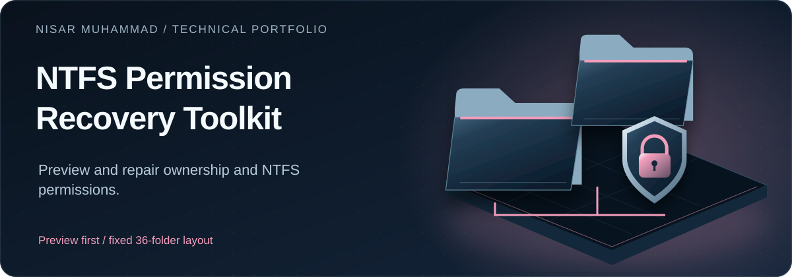

<picture>
  <source media="(max-width: 640px)" srcset="assets/phase2/hero-mobile.svg" />
  
</picture>

# NTFS Permission Recovery Toolkit

A free PowerShell toolkit for repairing NTFS ownership and permissions in a specific 36-folder layout. It cannot recover deleted files, repair storage hardware, or guarantee restoration of corrupted data.

> [!IMPORTANT]
> **Review Preview and verify that your backup can be restored before using Apply.** Ownership and permission changes can lock users out or expose private files. Read [Safety, user responsibilities and liability](#safety-user-responsibilities-and-liability) before running the toolkit.

##  New to PowerShell? Start Here — Beginner's Step-by-Step PDF Guide

[Open the Beginner's Step-by-Step PDF Guide](docs/NTFS_Permission_Recovery_Beginners_Step_by_Step_Guide.pdf)

Learn how to download the toolkit from GitHub, extract the ZIP, run Preview, understand the four recovery batches, review the logs, and safely use Apply mode after verifying a recoverable backup. If a PowerShell example wraps in the PDF, enter the command on one line.

##  Requirements

Use Windows PowerShell 5.1, a fixed local NTFS volume, and a data folder with exactly 36 immediate subfolders. Use an elevated Windows PowerShell window for Apply. Preview needs read access to the selected trees and write access to the log directory. The intended client platforms are Windows 10 and Windows 11 on builds with the required Windows tools. Consult [Safety and limitations](docs/Safety_and_Limitations.md) for validation scope.

##  Download

Download the [toolkit ZIP](releases/NTFS_Permission_Recovery_Toolkit_V1.zip) and extract it, or download the [PowerShell script](scripts/NTFS_Recovery_Public_V1.ps1) using GitHub’s **Raw** view. The [PDF guide](docs/NTFS_Permission_Recovery_User_Guide.pdf) and [Markdown guide](docs/NTFS_Permission_Recovery_User_Guide.md) explain setup and verification.

##  Preview first

Open Windows PowerShell in the extracted toolkit folder. Replace the example root with your disposable test copy and use a separate log folder.

```powershell
.\scripts\NTFS_Recovery_Public_V1.ps1 -Root 'C:\RecoveryTest\SampleFolder' -Batch 1 -LogRoot 'C:\RecoveryTest\Logs'
```

Preview checks the sorted folder list and selected tree, then writes a manifest and a selection log. It leaves ownership and ACLs unchanged.

| Batch | Positions in the sorted list |
| --- | --- |
| 1 | 1–10 |
| 2 | 11–20 |
| 3 | 21–30 |
| 4 | 31–36 |

## Apply one batch

Verify that the backup can be restored, review the parent ACL and explicit denies, and keep the tree and logs under your exclusive control. From an elevated Windows PowerShell window in the same extracted folder, reuse the root, batch, and log directory from preview.

```powershell
.\scripts\NTFS_Recovery_Public_V1.ps1 -Root 'C:\RecoveryTest\SampleFolder' -Batch 1 -LogRoot 'C:\RecoveryTest\Logs' -Apply -BackupVerified
```

Type `APPLY BATCH 1` when prompted. The script attempts a DACL snapshot, recursively assigns ownership to local Administrators, grants Administrators Full Control, and enables inheritance. A failed step can leave partial changes. Review the log, CSV and snapshots, then test effective access with the intended accounts and applications.

See [Troubleshooting](docs/Troubleshooting.md), [safety and limitations](docs/Safety_and_Limitations.md), and the [disclaimer](DISCLAIMER.md).

## License

The [MIT License](LICENSE) permits free personal and commercial use, modification, and redistribution. Retain the copyright and license notice. The software comes without warranty. You are responsible for testing, authorization, and deployment.

Created and maintained by Nisar Muhammad.

## Safety, user responsibilities and liability

- Use the toolkit only on a target you are authorized to administer. Confirm the exact target and review the Preview selection before Apply. Verify a recoverable backup and test first on a disposable copy.
- Ownership and NTFS permission changes can remove legitimate access or expose private files. For the intended accounts, verify effective access after any change. Keep logs, manifests, and snapshots private.
- Apply can leave partial changes that require manual recovery. A DACL snapshot does not replace a verified backup or guarantee restoration of ownership.
- The toolkit repairs ownership and permissions. It does not recover deleted files, and successful repair or restoration is not guaranteed.

You are responsible for authorization, target selection, testing, backups, and the effects of deployment. The toolkit is provided as is under the [MIT License](LICENSE), without warranty. To the extent permitted by applicable law, the author is not liable for losses or damage arising from use. See [Safety and limitations](docs/Safety_and_Limitations.md) and the [disclaimer](DISCLAIMER.md).
